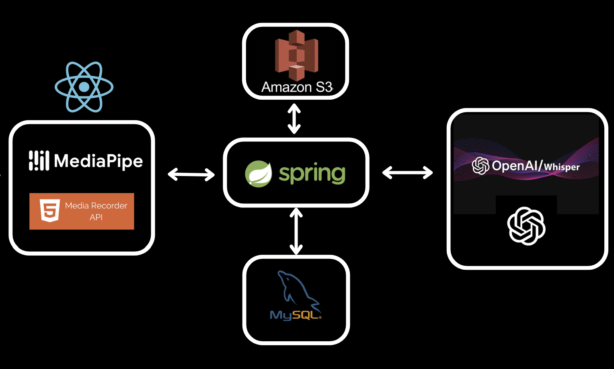
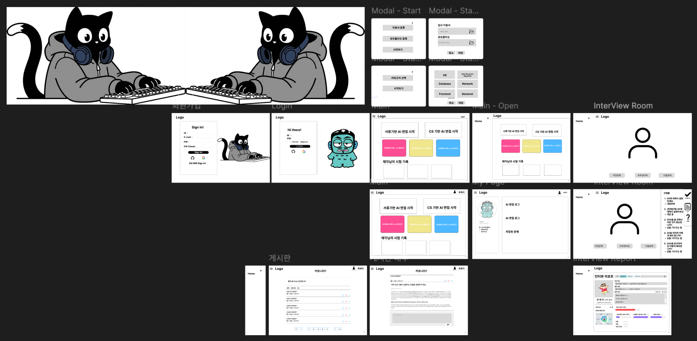

# DADAP | AI 면접 코칭 서비스

<p align="center">
  
</p>

> **AI 기반 면접 코칭 서비스 (SSAFY 14기 D203 공통 프로젝트)**
> **개발 기간:** 2025.01.06 ~ 2025.02.13

---

## 📌 프로젝트 개요

DADAP은 CS/포트폴리오 면접을 **실전처럼 연습**하고, **AI가 답변 및 비언어적 요소를 분석하여 피드백을 제공하는 면접 코칭 서비스**입니다.
단순 연습이 아니라, **질문 생성 → 답변 분석 → 꼬리 질문 → 종합 리포트**까지 이어지는 전 과정을 지원합니다.

---

## 🎯 왜 만들었나요

면접 준비 과정에서 발생하는 다음과 같은 문제를 해결하고자 했습니다.

* **반복 연습의 비용 문제**

  * 실전과 유사한 환경을 구축하기 어렵고, 지속적인 피드백을 받을 수 있는 인적 자원이 부족함.

* **피드백의 편차 문제**

  * 면접관마다 평가 기준이 달라 개선 방향을 잡기 어려움.

* **비언어적 요소 분석의 한계**

  * 시선, 표정, 자세 등은 본인이 객관적으로 점검하기 어려움.

➡️ **DADAP은 AI 기반 면접 시뮬레이션 + 정량/정성 피드백을 결합하여 해결합니다.**

---

## 👥 대상 사용자

* 취업/이직을 준비하는 주니어 개발자
* CS/기술 면접 대비가 필요한 수강생 및 예비 개발자
* 포트폴리오 면접 대비가 필요한 사용자

---

## 🚀 기대 효과

* **면접 준비 효율 향상**: 반복 연습과 즉각적인 피드백 제공
* **정량화된 개선 포인트 제공**: 발화, 시선, 표정 등 데이터 기반 분석
* **실전 감각 강화**: 실전 모드 제공으로 긴장도 관리 및 응답 품질 향상

---

## ✨ 핵심 기능

* AI 기반 CS / 포트폴리오 면접 코칭
* **연습 모드 / 실전 모드 분리 제공**
* CS 개념 학습을 위한 학습 페이지 제공
* AI 답변 분석 및 면접관 관점의 피드백 제공
* 사용자 답변 기반 **꼬리 질문 자동 생성**
* 면접 결과 리포트 생성 및 조회
* 커뮤니티 게시판 (게시글 / 댓글 / 좋아요)
* OAuth 소셜 로그인 (GitHub / Google), 이메일 기반 비밀번호 재설정

---

## 🏗 시스템 아키텍처

<p align="center">
  
</p>

### 구성 요소

* **Frontend**: React + Vite 기반 SPA

  * 면접 UI, 리포트, 학습 페이지, 커뮤니티 제공

* **Backend**: Spring Boot API 서버

  * 인증, 면접 관리, 게시판, 리포트, 스토리지 관리

* **AI Server**: FastAPI 기반 LLM 서버

  * 답변 분석, 영상 분석, 피드백 생성

* **Storage / DB**

  * MySQL, Redis, AWS S3

---

### 데이터 흐름 (요약)

1. 사용자가 면접 질문에 답변 (음성/영상)
2. 프론트엔드에서 **MediaPipe / Face API** 등으로 비언어 지표 추출
3. 백엔드로 **음성/영상 업로드 및 세션 기록 저장**
4. AI 서버로 **텍스트 + 비언어 지표 전달 → LLM이 피드백 생성**
5. 사용자에게 **개선 포인트 + 요약 리포트 제공**

---

## 🛠 기술 스택

### 🔹 Collaboration Tools

*  **Git**
*  **GitLab**
*  **Notion**
*  **Jira**

### 🔹 Backend

*  **Spring Boot 3.5**
*  **Java 21**
*  **FastAPI (AI Server)**

### 🔹 Frontend

*  **TypeScript**
*  **React 19**
*  **Vite 7**
*  **Tailwind CSS v4**
*  **Node.js 24**
*  **PostCSS**

### 🔹 Infra / DevOps

*  **Docker / docker-compose**
*  **AWS (S3, EC2)**
*  **Ubuntu Server**
*  **Nginx (Reverse Proxy)**

### 🔹 Tools (개발 환경)

*  **VS Code**
*  **IntelliJ IDEA**

---

## ⚙️ 개발 환경

### Frontend

* Node.js `v24.13.0`
* npm `v11.6.2`

### Backend

* Java 21
* Gradle

### AI Server

* Python (requirements.txt 기반)

---

## ▶️ 실행 방법 (로컬 예시)

```bash
# frontend
cd frontend/pjt
npm install
npm run dev

# backend
cd backend/dapdap
./gradlew bootRun

# ai server
cd ai-server
pip install -r requirements.txt
uvicorn main:app --reload
```
## 실행 방법 (서버 예시)
> Docker 기반 배포 환경에서 실행됩니다.  
> 자세한 설정 및 환경 변수는 `exec/PORTING_MANUAL.md` 참고

---

## 📁 폴더 구조 (요약)

```
.
├── ai-server/           # FastAPI 기반 AI 서버
├── backend/             # Spring Boot 백엔드
├── frontend/            # React 프론트엔드
├── deploy/              # Docker 배포 설정
└── img/                 # 이미지 리소스 (로고/와이어프레임 등)
```

---

## 📚 참고 문서

* `backend/dapdap/API.md`: 백엔드 API 명세서
* `frontend/pjt/DADAP API SPEC.md`: 프론트 기준 API 스펙
* `ai-server/README.md`: AI 서버 구조 및 로직 설명

---

## 🖼 와이어프레임

<p align="center">
  
</p>

## 🖼 화면 구성
### 포트폴리오 업로드
<p align="center">
  
</p>


### 포트폴리오 면접
<p align="center">
  
</p>

### 실전 면접 및 면접 결과
<p align="center">
  
</p>


### 마이페이지
<p align="center">
  
</p>

### 아카이브 화면
<p align="center">
  
</p>

### 학습 페이지
<p align="center">
  
</p>

### P2P
<p align="center">
  
</p>
